# Transfer learning for kidney CT classification: a comparison of five ImageNet CNNs


This repository contains the code, experiments and results of our research project on kidney CT classification [11], carried out under the Father Locke and Stiller Research Award (LSRA) at St. Xavier's College, Kathmandu. It compares five ImageNet-pretrained CNNs (VGG16, MobileNet, ResNet50, InceptionV3 and Xception) for classifying kidney CT slices as **Cyst, Normal, Stone or Tumor**.

Each network is used as a frozen feature extractor: 150×150 input, global max pooling, and a Dense–BatchNorm–Dropout head tuned with keras-tuner. The data are split 70/15/15 by image into train, validation and test sets, hyperparameters are chosen on the validation set, and the test set is used once per model. All five models reach **98.7–99.9%** test accuracy, with ResNet50 best at 99.89%.

It is **not** a measure of performance on new patients. Under this image-level split, 99.9% of test images come from a CT scan that also has slices in the training set. When whole scans are held out, the same frozen models reach only 56–67%, and a fine-tuned MobileNet ensemble reaches about 81% (see [Limitations](#limitations)).

The full write-up, with every table and figure rebuilt from the saved results, is the notebook [`notebooks/kidney_ct_transfer_learning.ipynb`](notebooks/kidney_ct_transfer_learning.ipynb). It needs only pandas, numpy and matplotlib.

## Highlights

Test set: 1,853 images, each model evaluated once. 95% CIs are percentile bootstraps over test images (1,000 resamples).

| Model | Test accuracy % [95% CI] | Macro-F1 % [95% CI] | Balanced acc. % | ROC-AUC (macro OvR) | Errors |
|---|---|---|---|---|---|
| VGG16 | 99.84 [99.62, 100.00] | 99.81 [99.57, 100.00] | 99.73 | 1.0000 | 3 / 1853 |
| MobileNet | 99.73 [99.46, 99.95] | 99.58 [99.11, 99.91] | 99.68 | 1.0000 | 5 / 1853 |
| **ResNet50** | **99.89 [99.73, 100.00]** | **99.86 [99.65, 100.00]** | **99.81** | **1.0000** | **2 / 1853** |
| InceptionV3 | 98.70 [98.11, 99.19] | 98.27 [97.43, 98.93] | 98.78 | 0.9997 | 24 / 1853 |
| Xception | 99.30 [98.87, 99.68] | 99.09 [98.54, 99.54] | 99.04 | 0.9999 | 13 / 1853 |

* **The top three are statistically indistinguishable.** ResNet50, VGG16 and MobileNet differ by a few errors and have overlapping CIs. InceptionV3 is the weakest, and most of its errors are Normal slices predicted as Stone.
* **Stone is the hardest class** for every model. It is the smallest class, and the lesions are small.
* **The same hyperparameters won everywhere:** 640 units and learning rate 1e-4, with dropout 0.2 or 0.3.
* **Leakage:** 99.9% of test images come from a scan with slices in training, and 97.4% have a near-identical training image. Scan-level evaluation gives 56–67% for these frozen models.

## Method

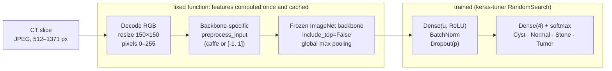

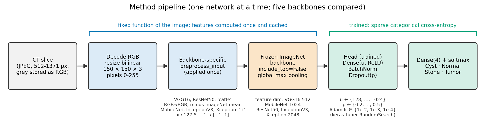

* **Backbones:** VGG16 [3], MobileNet [4], ResNet50 [5], InceptionV3 [6] and Xception [7], all with ImageNet [2] weights and frozen.
* **Preprocessing:**
  * VGG16 and ResNet50 use 'caffe' mode (RGB→BGR, minus the ImageNet mean);
  * MobileNet, InceptionV3 and Xception scale to [-1, 1];
  * in both cases it is applied once, to 0–255 pixels.
* **Head:** Flatten → Dense(units, ReLU) → BatchNorm → Dropout → Dense(4, softmax), trained with Adam on sparse categorical cross-entropy, batch size 32, no augmentation.
* **Search:** KerasTuner [8] `RandomSearch` on validation accuracy. Units 128–1024 (step 128), dropout 0.2–0.5 (step 0.1), learning rate {1e-2, 1e-3, 1e-4}; 10 trials × 3 executions × 10 epochs; seed 123. The best configuration is refitted for 10 epochs and evaluated once on the test set.
* **Cached features:** the backbone is frozen and there is no augmentation, so its output is a fixed function of each image. Features are computed once and the head is trained on them. This was checked to be numerically identical to end-to-end training: the maximum absolute difference in probabilities was 0.0 (`results/image_level/sanity_check.json`).

### Train / validation / test split

The split is a stratified 70/15/15 split by image (seed 123), saved to [`results/image_level/split.csv`](results/image_level/split.csv). The three subsets are asserted to be disjoint. The 1,034 byte-identical files (517 MD5 groups) are kept together in one subset, so no test image has an exact copy in training.

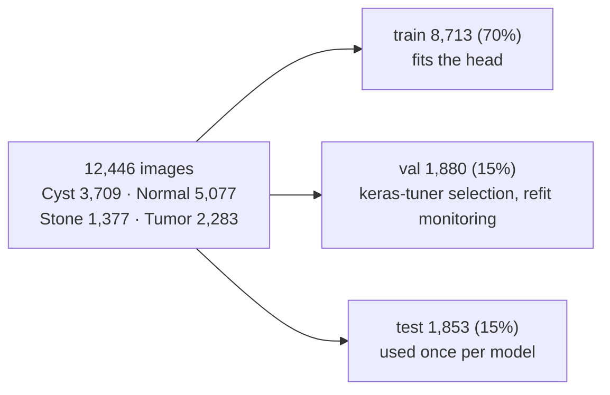

| Class | Train | Val | Test | Total |
|---|---|---|---|---|
| Cyst | 2,599 | 564 | 546 | 3,709 |
| Normal | 3,552 | 768 | 757 | 5,077 |
| Stone | 964 | 206 | 207 | 1,377 |
| Tumor | 1,598 | 342 | 343 | 2,283 |
| **Total** | **8,713** | **1,880** | **1,853** | **12,446** |

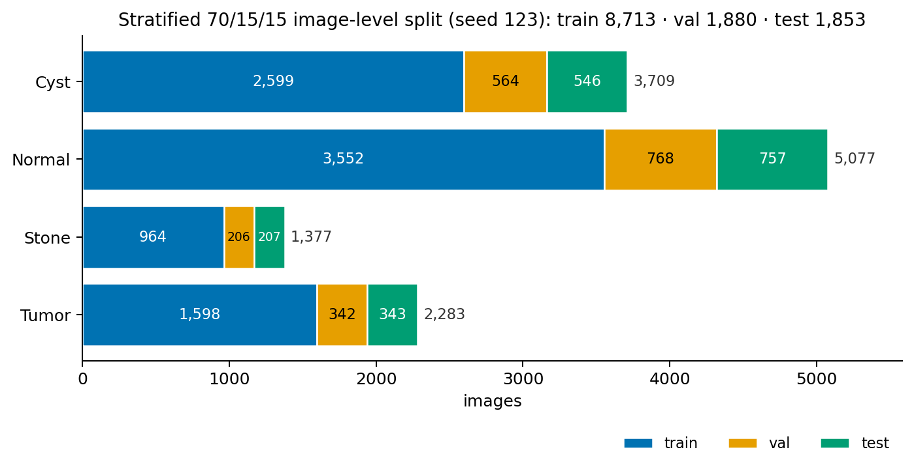

## Results

| | |
|---|---|
| 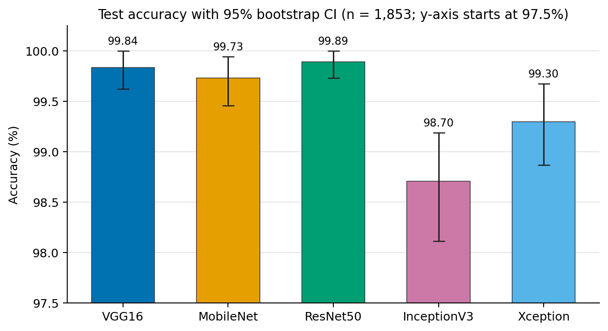 | 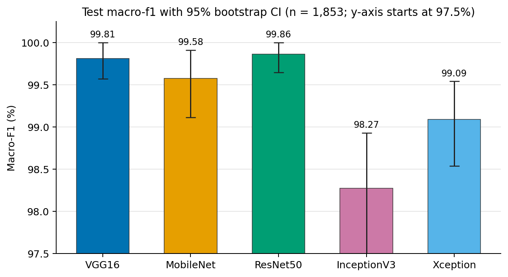 |

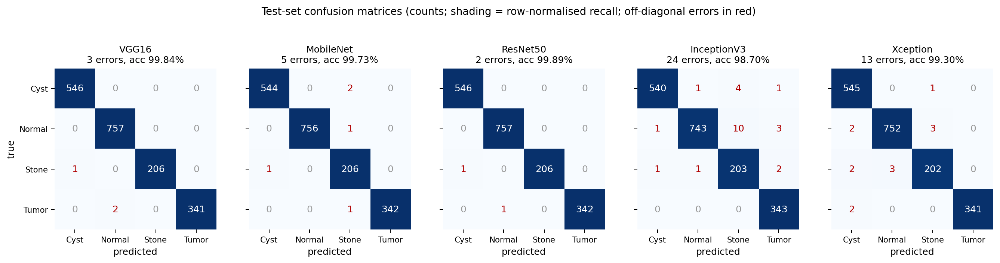

| | |
|---|---|
| 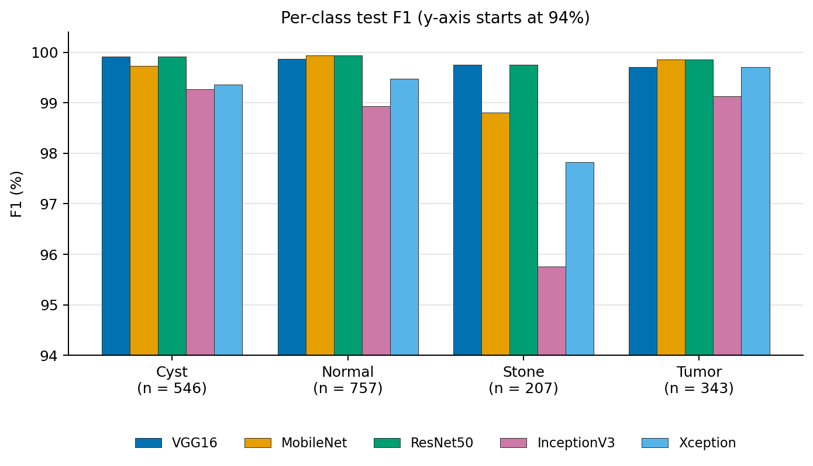 | 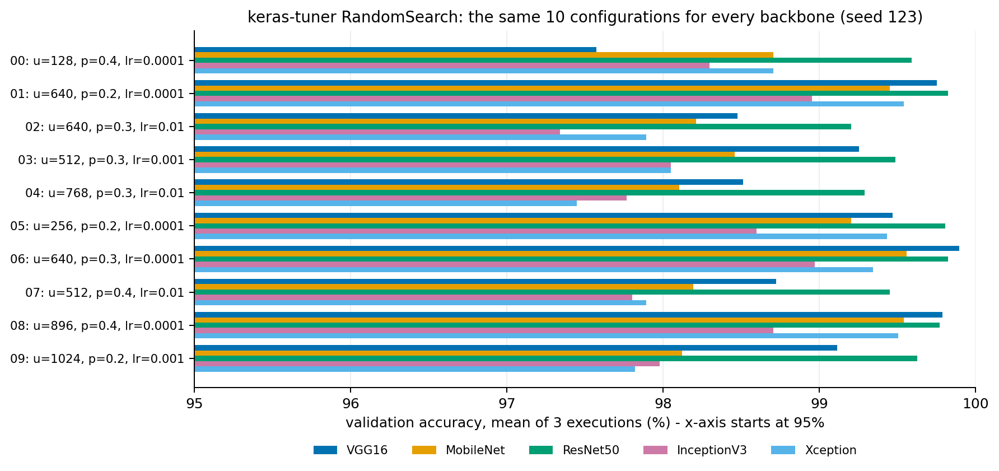 |

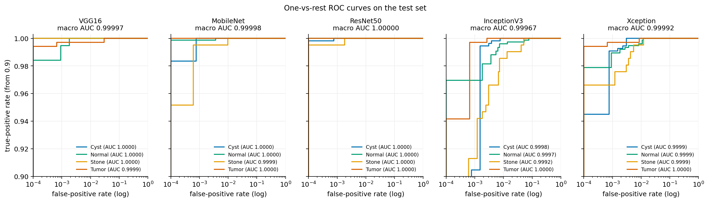

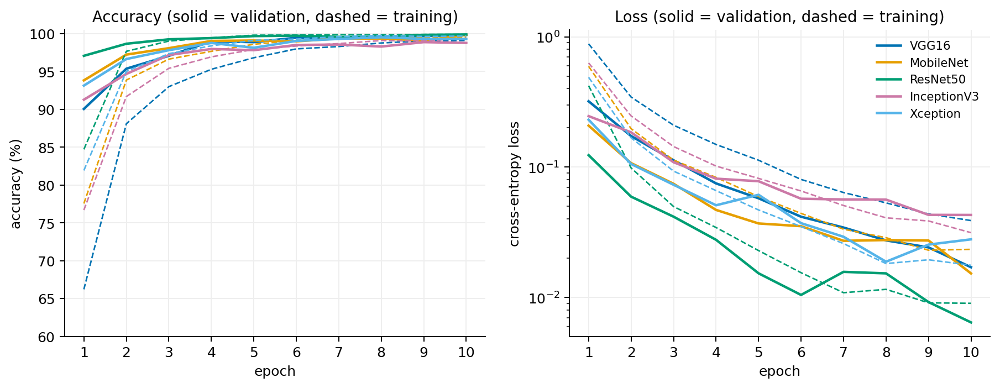

Selected hyperparameters:

| Model | Dense units | Dropout | Learning rate | Tuner val acc. | Feature dim |
|---|---|---|---|---|---|
| VGG16 | 640 | 0.3 | 1e-4 | 0.9989 | 512 |
| MobileNet | 640 | 0.3 | 1e-4 | 0.9956 | 1024 |
| ResNet50 | 640 | 0.2 | 1e-4 | 0.9982 | 2048 |
| InceptionV3 | 640 | 0.3 | 1e-4 | 0.9897 | 2048 |
| Xception | 640 | 0.2 | 1e-4 | 0.9954 | 2048 |

The per-model metrics, confusion matrices and run times are in [`results/image_level/REPORT.md`](results/image_level/REPORT.md).

## Evaluation protocol

| Step | Protocol |
|---|---|
| Split | Stratified 70/15/15 train/val/test split by image (seed 123). The three subsets are asserted to be disjoint, and byte-identical files are kept in one subset |
| Model selection | keras-tuner RandomSearch on the validation set only (10 trials × 3 executions × 10 epochs). The test set is used once per model |
| Preprocessing | Each network's own `preprocess_input`, applied once to 0–255 pixels |
| Metrics | Computed on argmax labels: accuracy with bootstrap CI, balanced accuracy, macro and weighted precision/recall/F1, per-class metrics, confusion matrices, ROC-AUC |
| Models | VGG16, MobileNet, ResNet50, InceptionV3 and Xception, with ImageNet weights |
| Fixed settings | 150×150 input, frozen backbone, global max pooling, 10-epoch refit of the best head, batch size 32 |

## Limitations

* **The image-level split leaks.** Consecutive file numbers in the dataset are neighbouring slices of one CT scan, and 204 scan groups can be recovered from slice order and image similarity. Under this split:
  * **1,852 of 1,853 test images (99.9%)** come from a scan that also has slices in training;
  * **97.4%** have a near-identical training image (32×32 thumbnail correlation ≥ 0.995).

  The scores therefore measure recognition of other slices of scans the model has already seen. They are not accuracy on new patients.
* **Scan-level results tell a different story.** With group-level 5-fold cross-validation, in which no scan is shared between training and test, the same frozen backbones score **56–67%**. The best model of the full study, an ensemble of two fine-tuned MobileNets, reaches **81.4%** (95% CI 75.8–86.5%). Those are the numbers to use for any claim about generalisation; see [`results/REPORT.md`](results/REPORT.md) and [`results/IMPROVEMENTS.md`](results/IMPROVEMENTS.md). That analysis used a different configuration (224 px input, average pooling, a head selected by macro-F1).
* **The confidence intervals are too narrow.** The bootstrap treats test images as independent, but slices of one scan are strongly correlated.
* **One split, one seed, one dataset.** There is no external validation and there are no patient identifiers.

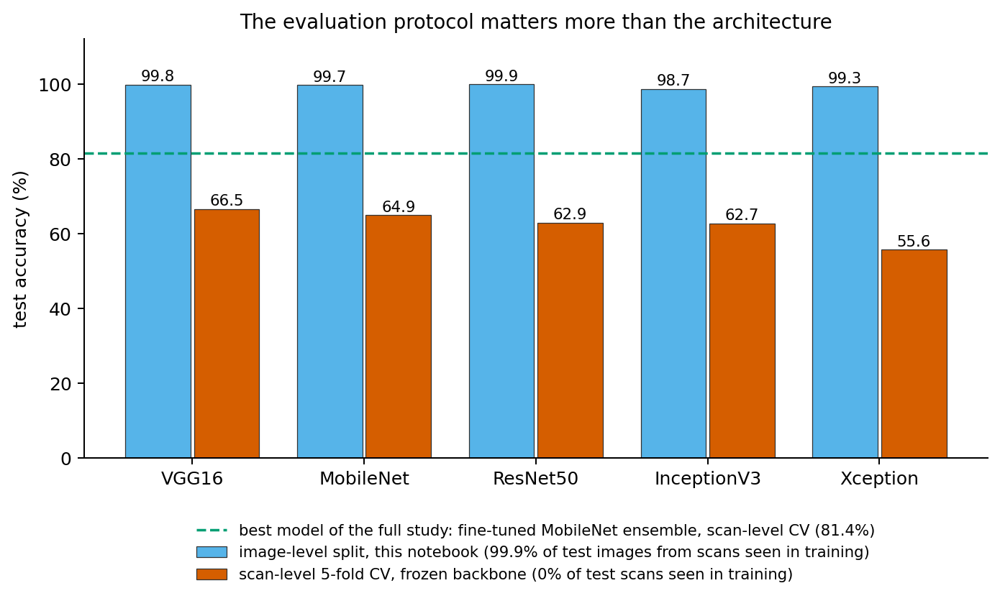

## Repository structure

```
.
├── README.md
├── LICENSE                         MIT (code only; the dataset has its own licence)
├── notebooks/
│   ├── kidney_ct_transfer_learning.ipynb   research write-up, runs from saved results (no TensorFlow)
│   ├── image_level_colab.ipynb             this experiment on a Colab GPU (cached or end-to-end)
│   └── reproduce_on_colab.ipynb            scan-level study on Colab
├── figures/                        every figure used here, generated by the write-up notebook
├── scripts/
│   ├── download_data.py            Kaggle (default) or Hugging Face mirror, with class-count check
│   ├── run_image_level.py          this experiment (resumable)
│   ├── report_image_level.py       writes results/image_level/REPORT.md
│   ├── build_notebook.py           builds the write-up notebook (unexecuted)
│   ├── run_experiment.py           scan-level study, stage 1 (results/REPORT.md)
│   ├── run_improvements.py         scan-level study, stage 2 (results/IMPROVEMENTS.md)
│   ├── run_finetune.py             scan-level study, stage 3 (fine-tuning)
│   └── run_all.py, ...             other drivers and comparisons
├── src/kidney_tl/
│   ├── image_level.py              split, duplicate grouping, metrics, bootstrap
│   ├── image_level_pipeline.py     decoding, preprocessing, backbones, input checks
│   └── ...                         scan grouping, CV splits, features, heads, fine-tuning, reports
├── results/
│   ├── image_level/                this experiment: REPORT.md, summary.csv, split.csv, per-model
│   │                               metrics.json, predictions.csv, history.csv, tuner_trials.csv
│   ├── REPORT.md, IMPROVEMENTS.md  scan-level analysis (secondary)
│   └── splits/, finetune/, ...     scan-level folds and outputs
├── docker/Dockerfile.image_level   TensorFlow 2.15 CPU image with ImageNet weights baked in
├── tests/                          pytest suite (synthetic data, no download needed)
├── requirements.txt  pyproject.toml  Makefile
```

## Reproduce

### 1. Data

The data are the *CT KIDNEY DATASET: Normal-Cyst-Tumor-Stone* (Islam et al., 2022 [1]): 12,446 JPEG slices, of which Cyst 3,709, Normal 5,077, Stone 1,377 and Tumor 2,283. The images are **not** included in this repository.

```bash
pip install kagglehub huggingface_hub pyarrow pillow
python scripts/download_data.py                        # Kaggle: nazmul0087/ct-kidney-dataset-normal-cyst-tumor-and-stone
python scripts/download_data.py --source huggingface   # faster mirror: mhmad240/kidney-ct-classification
```

The data go to `data/ct-kidney/<Class>/*.jpg`. The script refuses to continue unless the class counts match the Kaggle release.

### 2. Run the experiment in Docker (CPU; what produced `results/image_level/`)

```bash
docker build -f docker/Dockerfile.image_level -t kidney-image-level:2.15 docker/
docker run --rm --memory=3g --memory-swap=3g --cpus=4 \
    -e TF_NUM_INTRAOP_THREADS=4 -e TF_NUM_INTEROP_THREADS=2 \
    -v "$PWD":/work -w /work kidney-image-level:2.15 python scripts/run_image_level.py
```

The run is resumable: re-running the same command continues from the cached features, tuner trials and finished models. On 3–4 CPU cores it takes about 2.6 hours for all five models. `--sanity-check` repeats the cached-vs-end-to-end check, and `--report-only` rebuilds the tables.

### 3. Run locally

```bash
python -m venv .venv && source .venv/bin/activate
pip install -r requirements.txt keras-tuner==1.4.7
python scripts/run_image_level.py --data-dir data/ct-kidney
```

### 4. Colab (GPU)

Open [`notebooks/image_level_colab.ipynb`](notebooks/image_level_colab.ipynb) and set `REPO_ON_DRIVE`. `MODE="cached"` runs the script. `MODE="end_to_end"` trains the frozen backbone and the head together in one Keras model.

### 5. Rebuild the write-up and figures (no TensorFlow, no data)

```bash
pip install pandas numpy matplotlib nbconvert nbclient ipykernel
jupyter nbconvert --to notebook --execute --inplace notebooks/kidney_ct_transfer_learning.ipynb
```

### 6. Tests

```bash
pip install -r requirements.txt keras-tuner==1.4.7
pytest -q          # or: make test
```

The tests use a small synthetic dataset, so they need no download.

**Seeds and environment.** The split, the tuner and the batch shuffling use seed 123, as does the bootstrap. The run used TensorFlow 2.15.0, keras-tuner 1.4.7, numpy 1.26.4, pandas 2.2.3 and Python 3.11 (`results/image_level/environment.json`).

## Citation

The associated publication:

```bibtex
@article{maharjan2024kidneycnn,
  author  = {Maharjan, Rabin and Sitaula, Siddhartha},
  title   = {Convolutional Neural Network Architectures for Detection of Kidney Abnormalities: A Comparative Analysis},
  journal = {Research Annals of Xavier's Nepal},
  number  = {VI},
  year    = {2024},
  volume  = {TODO},
  pages   = {TODO},
  note    = {LSRA cycle VI}
}
```

This repository:

```bibtex
@software{sitaula2026kidneyct,
  author = {Sitaula, Siddhartha},
  title  = {Transfer learning for kidney CT classification: a comparison of five ImageNet CNNs},
  year   = {2026},
  url    = {https://github.com/sidsitaulaa/kidney-ct-transfer-learning}
}
```

## References

1. M. N. Islam, M. Hasan, M. K. Hossain, M. G. R. Alam, M. Z. Uddin and A. Soylu, "Vision transformer and explainable transfer learning models for auto detection of kidney cyst, stone and tumor from CT-radiography," *Scientific Reports*, vol. 12, art. 11440, 2022. [doi:10.1038/s41598-022-15634-4](https://doi.org/10.1038/s41598-022-15634-4)
2. J. Deng, W. Dong, R. Socher, L.-J. Li, K. Li and L. Fei-Fei, "ImageNet: A large-scale hierarchical image database," in *Proc. IEEE CVPR*, 2009, pp. 248–255. [doi:10.1109/CVPR.2009.5206848](https://doi.org/10.1109/CVPR.2009.5206848)
3. K. Simonyan and A. Zisserman, "Very deep convolutional networks for large-scale image recognition," in *Proc. ICLR*, 2015. [arXiv:1409.1556](https://arxiv.org/abs/1409.1556)
4. A. G. Howard, M. Zhu, B. Chen, D. Kalenichenko, W. Wang, T. Weyand, M. Andreetto and H. Adam, "MobileNets: Efficient convolutional neural networks for mobile vision applications," 2017. [arXiv:1704.04861](https://arxiv.org/abs/1704.04861)
5. K. He, X. Zhang, S. Ren and J. Sun, "Deep residual learning for image recognition," in *Proc. IEEE CVPR*, 2016, pp. 770–778. [doi:10.1109/CVPR.2016.90](https://doi.org/10.1109/CVPR.2016.90)
6. C. Szegedy, V. Vanhoucke, S. Ioffe, J. Shlens and Z. Wojna, "Rethinking the Inception architecture for computer vision," in *Proc. IEEE CVPR*, 2016, pp. 2818–2826. [doi:10.1109/CVPR.2016.308](https://doi.org/10.1109/CVPR.2016.308)
7. F. Chollet, "Xception: Deep learning with depthwise separable convolutions," in *Proc. IEEE CVPR*, 2017, pp. 1251–1258. [doi:10.1109/CVPR.2017.195](https://doi.org/10.1109/CVPR.2017.195)
8. T. O'Malley, E. Bursztein, J. Long, F. Chollet, H. Jin, L. Invernizzi et al., "KerasTuner," 2019. <https://github.com/keras-team/keras-tuner>
9. S. Kapoor and A. Narayanan, "Leakage and the reproducibility crisis in machine-learning-based science," *Patterns*, vol. 4, no. 9, art. 100804, 2023. [doi:10.1016/j.patter.2023.100804](https://doi.org/10.1016/j.patter.2023.100804)
10. E. Yagis, S. W. Atnafu, A. García Seco de Herrera, C. Marzi, R. Scheda, M. Giannelli, C. Tessa, L. Citi and S. Diciotti, "Effect of data leakage in brain MRI classification using 2D convolutional neural networks," *Scientific Reports*, vol. 11, art. 22544, 2021. [doi:10.1038/s41598-021-01681-w](https://doi.org/10.1038/s41598-021-01681-w)
11. R. Maharjan and S. Sitaula, "Convolutional neural network architectures for detection of kidney abnormalities: A comparative analysis," *Research Annals of Xavier's Nepal*, Issue VI, 2024.

## Licence

The code is released under the [MIT licence](LICENSE). The CT KIDNEY DATASET is **not** included and is distributed under its own licence by its authors; see the [Kaggle dataset page](https://www.kaggle.com/datasets/nazmul0087/ct-kidney-dataset-normal-cyst-tumor-and-stone) and cite Islam et al. (2022) [1] if you use it. ImageNet-pretrained weights are downloaded through Keras and are subject to their own terms.

## Author

**Siddhartha Sitaula**: [github.com/sidsitaulaa](https://github.com/sidsitaulaa) · [siddharthasitaula.com.np](https://siddharthasitaula.com.np)
