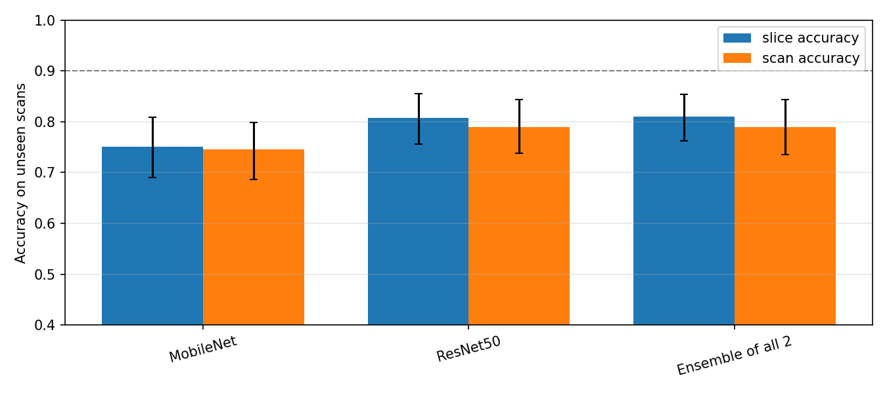
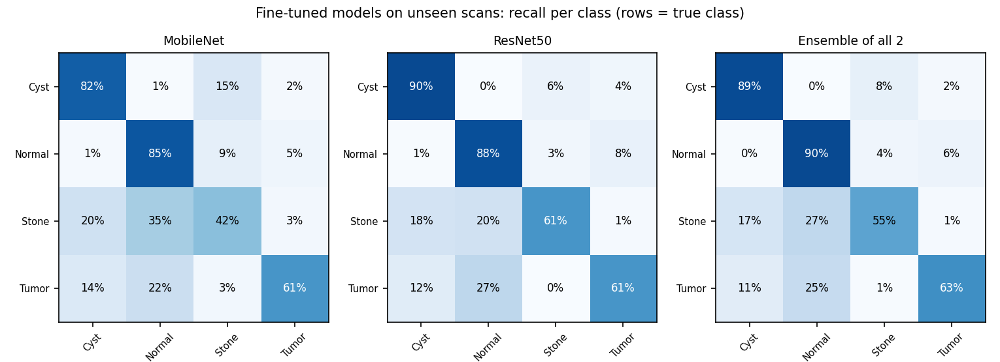

# Five-model comparison under identical conditions

**Protocol (identical for every model):** group-level 5-fold CV on 12,446 images from 204 scans
(no scan in both training and test); 224×224 input after cropping to the body and padding to a square; each network's
own ImageNet weights and `preprocess_input`; the final stage of each network is fine-tuned (layers after the cut in
`src/kidney_tl/stagewise.py`) with a classifier head that also sees mid-level (cut-stage) features; class-balanced loss;
Adam, 2 warm-up epochs at 1e-3 then up to 12 at 1e-4 with early stopping on validation scans; flip and shift augmentation.
95% CIs come from a scan-level bootstrap (100 resamples). Settings: `img_size=224, crop=True, stride=2, head_epochs=2, epochs=12, patience=3, batch_size=32, head_lr=0.001, lr=0.0001, dropout=0.5, multilevel_head=True, weights=imagenet`.

## 1. Results on unseen scans (fine-tuned, equal budget)

| Model | Slice accuracy [95% CI] | Slice macro-F1 [95% CI] | Balanced acc. | Cohen κ | MCC | ROC-AUC | Scan accuracy [95% CI] | Scan macro-F1 |
|---|---|---|---|---|---|---|---|---|
| MobileNet | 0.7510 [0.6905, 0.8084] | 0.6821 [0.6330, 0.7291] | 0.6765 | 0.6421 | 0.6435 | 0.9108 | 0.7451 [0.6860, 0.7990] | 0.7379 |
| ResNet50 | 0.8070 [0.7564, 0.8550] | 0.7582 [0.7107, 0.8049] | 0.7496 | 0.7207 | 0.7217 | 0.9383 | 0.7892 [0.7376, 0.8434] | 0.7619 |
| Ensemble of all 2 | 0.8099 [0.7624, 0.8542] | 0.7531 [0.7046, 0.7997] | 0.7434 | 0.7243 | 0.7258 | 0.9477 | 0.7892 [0.7353, 0.8431] | 0.7677 |

**Ranking by macro-F1:** ResNet50 (0.758), MobileNet (0.682).
Best single model: **ResNet50**, slice accuracy 0.8070, scan accuracy 0.7892.
The pre-declared ensemble (Ensemble of all 2) reaches slice accuracy 0.8099 and scan accuracy 0.7892.

## 2. Per class

| Model | Cyst precision | Cyst recall | Cyst f1 | Normal precision | Normal recall | Normal f1 | Stone precision | Stone recall | Stone f1 | Tumor precision | Tumor recall | Tumor f1 |
|---|---|---|---|---|---|---|---|---|---|---|---|---|
| MobileNet | 0.820 | 0.820 | 0.820 | 0.810 | 0.853 | 0.831 | 0.352 | 0.424 | 0.385 | 0.803 | 0.608 | 0.692 |
| ResNet50 | 0.860 | 0.900 | 0.879 | 0.833 | 0.882 | 0.857 | 0.671 | 0.607 | 0.638 | 0.717 | 0.609 | 0.659 |
| Ensemble of all 2 | 0.866 | 0.894 | 0.880 | 0.829 | 0.899 | 0.862 | 0.585 | 0.547 | 0.565 | 0.795 | 0.634 | 0.705 |

## 3. Are the differences real? (paired scan-level bootstrap on macro-F1, Holm-corrected)

| Model A | Model B | Δ macro-F1 (A − B) [95% CI] | p (Holm) | Significant |
|---|---|---|---|---|
| MobileNet | ResNet50 | -0.0761 [-0.1288, -0.0154] | 0.02 | yes |

## 4. Reaching 90%+ honestly: answer only when confident (selective prediction)

Thresholds are chosen on validation scans only; slices below the threshold are referred for human review.

| Model | Target (validation) | Test accuracy on answered slices [95% CI] | Coverage (share answered) | Cyst coverage | Normal coverage | Stone coverage | Tumor coverage |
|---|---|---|---|---|---|---|---|
| MobileNet | 90% | 0.8309 [0.7823, 0.8818] | 0.722 | 0.806 | 0.763 | 0.572 | 0.583 |
| ResNet50 | 90% | 0.8421 [0.7928, 0.8807] | 0.876 | 0.939 | 0.897 | 0.712 | 0.825 |
| Ensemble of all 2 | 90% | 0.8348 [0.7878, 0.8756] | 0.928 | 0.979 | 0.935 | 0.847 | 0.875 |
| MobileNet | 95% | 0.8806 [0.8329, 0.9190] | 0.508 | 0.608 | 0.559 | 0.298 | 0.360 |
| ResNet50 | 95% | 0.8900 [0.8250, 0.9280] | 0.725 | 0.781 | 0.775 | 0.463 | 0.682 |
| Ensemble of all 2 | 95% | 0.8921 [0.8483, 0.9337] | 0.735 | 0.829 | 0.778 | 0.521 | 0.617 |

## 5. How each model's accuracy changes with the evaluation and training protocol

| Model | Image-level CV, frozen (leaky) | Unseen scans: frozen + MLP | Unseen scans: frozen + LogReg | Unseen scans: fine-tuned (equal budget) | Unseen scans: fine-tuned, per scan |
|---|---|---|---|---|---|
| MobileNet | 0.9997 | 0.6486 | 0.6945 | 0.7510 | 0.7451 |
| ResNet50 | 0.9996 | 0.6289 | 0.6591 | 0.8070 | 0.7892 |

## 6. Published accuracies for this dataset (random image-level splits unless stated)

| Model | Reported accuracy | Source and split | Link |
|---|---|---|---|
| VGG16 | 98.20% | Islam et al., Sci. Rep. 2022 (dataset paper), random 80/20 split | https://pmc.ncbi.nlm.nih.gov/articles/PMC9259587/ |
| ResNet50 | 73.80% | Islam et al., Sci. Rep. 2022, random 80/20 split | https://pmc.ncbi.nlm.nih.gov/articles/PMC9259587/ |
| InceptionV3 | 61.60% | Islam et al., Sci. Rep. 2022, random 80/20 split | https://pmc.ncbi.nlm.nih.gov/articles/PMC9259587/ |
| InceptionV3 | 99.82% | NCI Dublin MSc thesis 2024, random split | https://norma.ncirl.ie/8792/ |
| MobileNet (V2) | 99.64% (val.) | BEEI 2025, random split | https://beei.org/index.php/EEI/article/view/10084 |
| VGG16 / InceptionV3 / MobileNetV2 | 99.21% / 97.38% / 95.29% | BRAC University thesis 2022, random split | https://dspace.bracu.ac.bd/items/0e04b749-0932-44bf-8525-52bdac06b2f5 |
| ResNet-50 / Inception-v3 / MobileNet-v3 | 82.35% / 87.64% / 85.30% | NephroNet benchmark 2025, file-name-based patient grouping | https://pmc.ncbi.nlm.nih.gov/articles/PMC13337462 |
| Kidney-stone CT detector (other dataset) | 99.1% random vs 90.5% patient-wise | SSRN leakage reassessment, three centres | https://papers.ssrn.com/sol3/papers.cfm?abstract_id=7117201 |

Random-split scores (95–100%) are matched by this study's image-level CV (≥ 99.8% for every model), because adjacent
slices of the same scan land in both training and test. They measure recognition of seen scans, not generalisation
to new patients.
