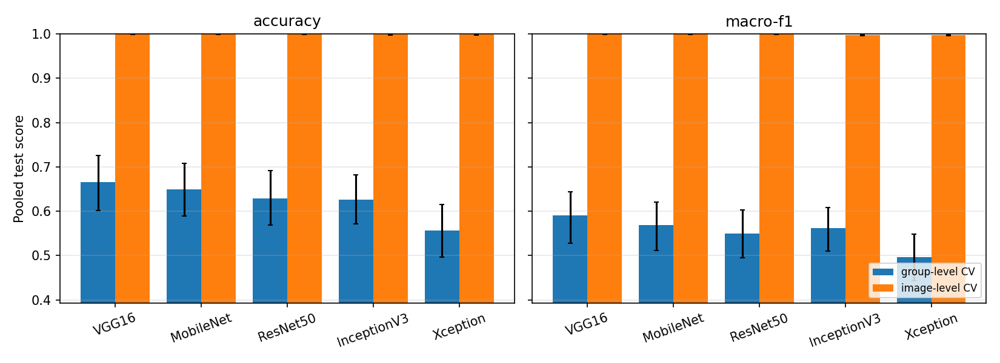
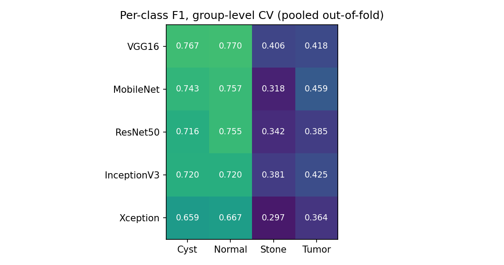
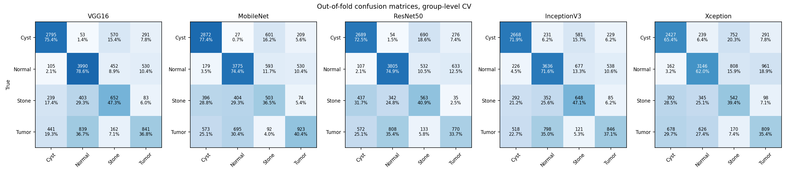

# Results: leakage-aware transfer learning for kidney CT classification

Generated 2026-10-24 06:28 in 89 min · TensorFlow 2.15.1 · CPU, 6 threads ·
12,446 images · 204 scan groups · classes Cyst, Normal, Stone, Tumor

**Headline (group-level CV, the primary estimate):** the best model is **VGG16**, with accuracy
**0.6651 [0.6016, 0.7262]** and macro-F1 **0.5901 [0.5282, 0.6438]**
(pooled over 5 folds; 95% CIs from 2,000 scan-level bootstrap resamples).

## 1. Protocol

* 5 ImageNet-pretrained backbones (VGG16, MobileNet, ResNet50, InceptionV3, Xception),
  frozen, each with its own `preprocess_input`, 224×224 input, global average pooling.
* Head: Dense → BatchNorm → Dropout → softmax, class-balanced loss, batch 256,
  early stopping on validation loss (patience 8).
  The head setting (4 candidates) is chosen in each fold by **validation macro-F1**; the test fold is never used.
* **Scan groups.** Within each class, file numbers follow slice order. A new scan starts where consecutive slices stop
  correlating (r < 0.9); scans stored twice (byte-identical or r ≥ 0.995 slices) are merged.
* **Protocols**
  * **group-level CV (primary):** stratified group 5-fold; every scan is tested once and never seen in training.
  * **image-level CV:** stratified 5-fold by image, as in most published work on this dataset.
* Metrics are pooled over all out-of-fold predictions. CIs and model comparisons resample **whole scan groups**,
  because slices of one scan are not independent.

## 2. Data and scan groups

| Class | Images | Slice sequences | Scan groups | Median images / group | Largest group |
|---|---|---|---|---|---|
| Cyst | 3709 | 77 | 69 | 28.0 | 300 |
| Normal | 5077 | 49 | 48 | 107.5 | 189 |
| Stone | 1377 | 70 | 63 | 13.0 | 173 |
| Tumor | 2283 | 28 | 24 | 84.5 | 222 |

## 3. Leakage check

| Protocol | Folds | Train / fold | Val / fold | Test / fold | Test file also in train (%) | Test byte-identical to a train image (%) | Test near-identical to a train image (r ≥ 0.995, %) | Test scan also in train (%) |
|---|---|---|---|---|---|---|---|---|
| group-level CV | 5 | 8525 | 1431 | 2489 | 0.0 | 0.0 | 0.0 | 0.0 |
| image-level CV | 5 | 8462 | 1494 | 2489 | 0.0 | 5.5 | 97.2 | 100.0 |

## 4. Main results: group-level CV

| Model | Accuracy [95% CI] | Balanced accuracy [95% CI] | Macro-F1 [95% CI] | Macro precision | Macro recall | Cohen κ | MCC | ROC-AUC | Accuracy per fold (mean ± SD) |
|---|---|---|---|---|---|---|---|---|---|
| VGG16 | 0.6651 [0.6016, 0.7262] | 0.5953 [0.5372, 0.6548] | 0.5901 [0.5282, 0.6438] | 0.5932 | 0.5953 | 0.5209 | 0.5223 | 0.8347 | 0.6638 ± 0.0621 |
| MobileNet | 0.6486 [0.5895, 0.7085] | 0.5719 [0.5184, 0.6282] | 0.5692 [0.5116, 0.6200] | 0.5744 | 0.5719 | 0.4992 | 0.5006 | 0.8206 | 0.6492 ± 0.0657 |
| InceptionV3 | 0.6265 [0.5709, 0.6823] | 0.5692 [0.5193, 0.6215] | 0.5615 [0.5105, 0.6078] | 0.5657 | 0.5692 | 0.4694 | 0.4711 | 0.8149 | 0.6283 ± 0.0588 |
| ResNet50 | 0.6289 [0.5686, 0.6909] | 0.5551 [0.5013, 0.6122] | 0.5493 [0.4947, 0.6027] | 0.5523 | 0.5551 | 0.4716 | 0.4730 | 0.8173 | 0.6297 ± 0.0400 |
| Xception | 0.5563 [0.4965, 0.6147] | 0.5055 [0.4526, 0.5625] | 0.4968 [0.4430, 0.5482] | 0.4997 | 0.5055 | 0.3817 | 0.3841 | 0.7630 | 0.5550 ± 0.0655 |

## 5. image-level CV

| Model | Accuracy [95% CI] | Balanced accuracy [95% CI] | Macro-F1 [95% CI] | Macro precision | Macro recall | Cohen κ | MCC | ROC-AUC | Accuracy per fold (mean ± SD) |
|---|---|---|---|---|---|---|---|---|---|
| MobileNet | 0.9997 [0.9993, 0.9999] | 0.9994 [0.9986, 1.0000] | 0.9995 [0.9990, 0.9999] | 0.9997 | 0.9994 | 0.9995 | 0.9995 | 1.0000 | 0.9997 ± 0.0003 |
| ResNet50 | 0.9996 [0.9992, 0.9999] | 0.9996 [0.9990, 0.9999] | 0.9995 [0.9990, 0.9999] | 0.9995 | 0.9996 | 0.9994 | 0.9994 | 1.0000 | 0.9996 ± 0.0006 |
| VGG16 | 0.9995 [0.9990, 0.9999] | 0.9993 [0.9982, 0.9999] | 0.9993 [0.9985, 0.9999] | 0.9994 | 0.9993 | 0.9993 | 0.9993 | 1.0000 | 0.9995 ± 0.0007 |
| InceptionV3 | 0.9982 [0.9972, 0.9989] | 0.9973 [0.9956, 0.9985] | 0.9977 [0.9964, 0.9986] | 0.9982 | 0.9973 | 0.9974 | 0.9974 | 1.0000 | 0.9982 ± 0.0010 |
| Xception | 0.9980 [0.9969, 0.9989] | 0.9979 [0.9964, 0.9989] | 0.9975 [0.9959, 0.9987] | 0.9972 | 0.9979 | 0.9971 | 0.9971 | 1.0000 | 0.9980 ± 0.0008 |

## 6. How much the evaluation protocol changes the numbers

| Model | group-level CV: accuracy | group-level CV: macro-F1 | image-level CV: accuracy | image-level CV: macro-F1 |
|---|---|---|---|---|
| VGG16 | 0.6651 [0.6016, 0.7262] | 0.5901 [0.5282, 0.6438] | 0.9995 [0.9990, 0.9999] | 0.9993 [0.9985, 0.9999] |
| MobileNet | 0.6486 [0.5895, 0.7085] | 0.5692 [0.5116, 0.6200] | 0.9997 [0.9993, 0.9999] | 0.9995 [0.9990, 0.9999] |
| ResNet50 | 0.6289 [0.5686, 0.6909] | 0.5493 [0.4947, 0.6027] | 0.9996 [0.9992, 0.9999] | 0.9995 [0.9990, 0.9999] |
| InceptionV3 | 0.6265 [0.5709, 0.6823] | 0.5615 [0.5105, 0.6078] | 0.9982 [0.9972, 0.9989] | 0.9977 [0.9964, 0.9986] |
| Xception | 0.5563 [0.4965, 0.6147] | 0.4968 [0.4430, 0.5482] | 0.9980 [0.9969, 0.9989] | 0.9975 [0.9959, 0.9987] |

## 7. Per-class results, group-level CV

| Model | Cyst precision | Cyst recall | Cyst f1 | Cyst specificity | Normal precision | Normal recall | Normal f1 | Normal specificity | Stone precision | Stone recall | Stone f1 | Stone specificity | Tumor precision | Tumor recall | Tumor f1 | Tumor specificity |
|---|---|---|---|---|---|---|---|---|---|---|---|---|---|---|---|---|
| VGG16 | 0.781 | 0.754 | 0.767 | 0.910 | 0.755 | 0.786 | 0.770 | 0.824 | 0.355 | 0.473 | 0.406 | 0.893 | 0.482 | 0.368 | 0.418 | 0.911 |
| MobileNet | 0.714 | 0.774 | 0.743 | 0.869 | 0.770 | 0.744 | 0.757 | 0.847 | 0.281 | 0.365 | 0.318 | 0.884 | 0.532 | 0.404 | 0.459 | 0.920 |
| ResNet50 | 0.707 | 0.725 | 0.716 | 0.872 | 0.760 | 0.749 | 0.755 | 0.837 | 0.294 | 0.409 | 0.342 | 0.878 | 0.449 | 0.337 | 0.385 | 0.907 |
| InceptionV3 | 0.720 | 0.719 | 0.720 | 0.881 | 0.725 | 0.716 | 0.720 | 0.813 | 0.320 | 0.471 | 0.381 | 0.875 | 0.498 | 0.371 | 0.425 | 0.916 |
| Xception | 0.663 | 0.654 | 0.659 | 0.859 | 0.722 | 0.620 | 0.667 | 0.836 | 0.239 | 0.394 | 0.297 | 0.844 | 0.375 | 0.354 | 0.364 | 0.867 |

## 8. Are the differences between models real? (group-level CV, paired scan-level bootstrap, Holm-corrected)

Macro-F1:

| Model A | Model B | Difference (A − B) | 95% CI | p | p (Holm) | Significant at 0.05 |
|---|---|---|---|---|---|---|
| VGG16 | MobileNet | +0.0209 | [-0.0253, +0.0629] | 0.371 | 1 | no |
| VGG16 | ResNet50 | +0.0408 | [-0.0017, +0.0810] | 0.06 | 0.36 | no |
| VGG16 | InceptionV3 | +0.0286 | [-0.0115, +0.0673] | 0.15 | 0.75 | no |
| VGG16 | Xception | +0.0933 | [+0.0448, +0.1385] | 0.0005 | 0.005 | yes |
| MobileNet | ResNet50 | +0.0199 | [-0.0245, +0.0626] | 0.375 | 1 | no |
| MobileNet | InceptionV3 | +0.0077 | [-0.0371, +0.0516] | 0.699 | 1 | no |
| MobileNet | Xception | +0.0724 | [+0.0324, +0.1167] | 0.001 | 0.009 | yes |
| ResNet50 | InceptionV3 | -0.0122 | [-0.0493, +0.0267] | 0.581 | 1 | no |
| ResNet50 | Xception | +0.0525 | [+0.0152, +0.0907] | 0.008 | 0.056 | no |
| InceptionV3 | Xception | +0.0647 | [+0.0244, +0.1040] | 0.002 | 0.016 | yes |

Accuracy:

| Model A | Model B | Difference (A − B) | 95% CI | p | p (Holm) | Significant at 0.05 |
|---|---|---|---|---|---|---|
| VGG16 | MobileNet | +0.0165 | [-0.0256, +0.0563] | 0.452 | 1 | no |
| VGG16 | ResNet50 | +0.0362 | [-0.0026, +0.0720] | 0.063 | 0.372 | no |
| VGG16 | InceptionV3 | +0.0386 | [-0.0023, +0.0776] | 0.062 | 0.372 | no |
| VGG16 | Xception | +0.1088 | [+0.0564, +0.1593] | 0.0005 | 0.005 | yes |
| MobileNet | ResNet50 | +0.0198 | [-0.0214, +0.0582] | 0.353 | 1 | no |
| MobileNet | InceptionV3 | +0.0221 | [-0.0172, +0.0604] | 0.261 | 1 | no |
| MobileNet | Xception | +0.0923 | [+0.0494, +0.1396] | 0.0005 | 0.005 | yes |
| ResNet50 | InceptionV3 | +0.0023 | [-0.0339, +0.0377] | 0.882 | 1 | no |
| ResNet50 | Xception | +0.0726 | [+0.0324, +0.1159] | 0.001 | 0.008 | yes |
| InceptionV3 | Xception | +0.0702 | [+0.0287, +0.1133] | 0.001 | 0.008 | yes |

## 9. Selected head settings

| Protocol | Model | Units / learning rate chosen in each fold |
|---|---|---|
| group-level CV | VGG16 | 512/0.001, 256/0.001, 512/0.001, 256/0.001, 512/0.001 |
| image-level CV | VGG16 | 256/0.001, 512/0.001, 256/0.001, 256/0.001, 256/0.001 |
| group-level CV | MobileNet | 512/0.001, 256/0.0001, 512/0.001, 256/0.001, 512/0.0001 |
| image-level CV | MobileNet | 256/0.001, 256/0.001, 512/0.001, 256/0.001, 256/0.0001 |
| group-level CV | ResNet50 | 512/0.001, 512/0.0001, 512/0.001, 512/0.001, 256/0.0001 |
| image-level CV | ResNet50 | 256/0.001, 256/0.001, 256/0.001, 256/0.001, 256/0.001 |
| group-level CV | InceptionV3 | 512/0.001, 512/0.001, 512/0.0001, 256/0.001, 512/0.001 |
| image-level CV | InceptionV3 | 256/0.001, 256/0.0001, 256/0.001, 512/0.001, 512/0.0001 |
| group-level CV | Xception | 256/0.001, 512/0.0001, 256/0.0001, 256/0.001, 512/0.0001 |
| image-level CV | Xception | 256/0.001, 256/0.001, 512/0.001, 512/0.001, 256/0.001 |

## 10. Files

`pooled_metrics.csv` (all metrics, pooled), `per_fold_metrics.csv`, `fold_summary.csv`, `bootstrap_ci.csv`,
`model_comparisons.csv`, `head_search.csv`, `leakage_report.csv`, `scan_groups.csv`,
`splits/*_folds.csv` (which file was in which subset of which fold), `test_predictions.csv.gz`
(every out-of-fold prediction with class probabilities), `config.json`, `environment.json`, `run.log`.
